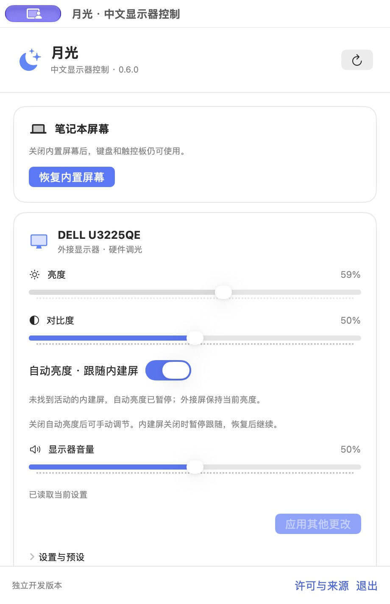
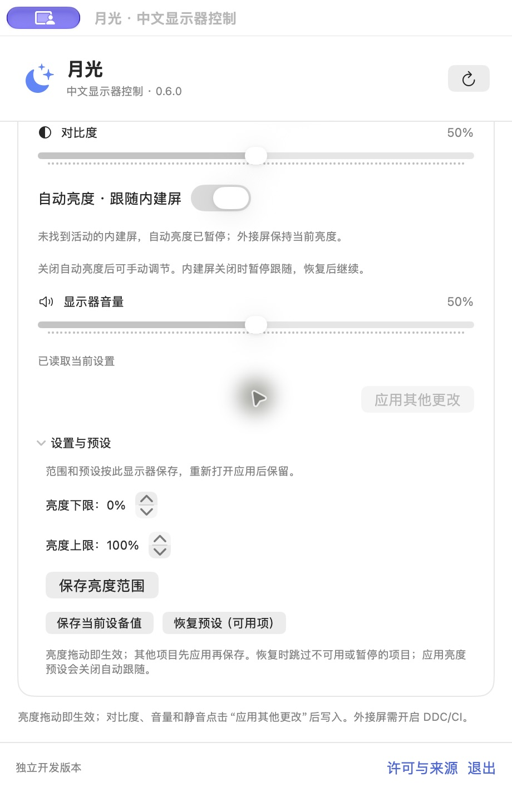

# 月光 · LunarCN

面向 Apple Silicon Mac 的独立中文显示器控制应用，当前版本 **0.6.0**，支持 macOS 13 或更高版本。

功能设计参考 [Lunar](https://github.com/alin23/Lunar)，DDC 后端基于 MIT 许可的 [m1ddc](https://github.com/waydabber/m1ddc)。本项目不是 Lunar 官方发行版，不包含 Lunar Pro 加密源码，当前也未实现原版的全部功能。

## 界面预览

以下为 0.6.0 在 Apple Silicon Mac 与 Dell 显示器上的真实截图。图中内建屏已关闭，自动亮度跟随处于暂停状态。

<p>
  
  
</p>

左图为主界面，右图为“设置与预设”展开后的视图。显示器音量等控制项按设备返回能力显示，实际兼容性见下文。

## 已实现

- 内建屏和支持 DDC/CI 的外接屏亮度拖动即调节，高频目标合并、串行写入和设备读回确认。
- 外接屏对比度，以及设备支持时的音量与静音。
- 外接屏自动跟随内建屏亮度，按屏保存开关和亮度上下限。
- 每屏一份预设、设置持久保存、损坏记录保护、显示器 ID／UUID 核对。
- 不合盖关闭笔记本内建屏，15 秒确认与独立恢复进程；退出或主进程异常结束时尝试恢复。
- 简体中文原生界面、菜单栏入口和单实例运行。

内建屏关闭期间自动亮度暂停；不同面板的相同百分比不代表相同的实际亮度。自动调光的传感器／时间模式、HDR/XDR、软件调光、输入源切换等仍待实现，详见[功能对照与验收清单](docs/lunar-feature-parity.zh-CN.md)。

## 下载安装（Apple Silicon）

当前提供 **[0.6.0 试用版](https://github.com/fengly78/LunarCN/releases/tag/v0.6.0)**：

- [DMG 安装包（推荐）](https://github.com/fengly78/LunarCN/releases/download/v0.6.0/LunarCN-0.6.0-arm64.dmg)：打开后将 LunarCN.app 拖入 Applications。
- [应用 ZIP](https://github.com/fengly78/LunarCN/releases/download/v0.6.0/LunarCN-0.6.0-arm64.zip)：解压后移入应用程序文件夹。
- [SHA-256 校验文件](https://github.com/fengly78/LunarCN/releases/download/v0.6.0/SHA256SUMS)。

仅支持 Apple Silicon（ARM64），最低 macOS 13。安装包使用本机临时签名，未经 Developer ID 签名或 Apple 公证，其他电脑可能被系统阻止打开。

## 构建与运行

需要 Apple Silicon Mac、macOS 13+ 和 Xcode 命令行工具。使用系统 Swift／Clang，无需下载 SwiftPM、Carthage 或第三方二进制依赖。

```sh
git clone https://github.com/fengly78/LunarCN.git
cd LunarCN
bash LunarCN/build.sh
open build/lunar-cn/LunarCN.app
```

构建脚本会运行不写入真实显示器的自检，并验证本机临时签名。

生成本地 DMG、应用 ZIP、源码 ZIP 和 SHA-256 校验文件（发行脚本另需 Python 3）：

```sh
bash LunarCN/release.sh
```

产物位于 `build/lunar-cn/releases/0.6.0/`。安装包见上方下载入口，也可使用本地打包流程；所有当前安装包均未经 Developer ID 签名或 Apple 公证。

## 使用与兼容性

开启显示器的 DDC/CI 后点击刷新。亮度拖动即生效；对比度、音量与静音点击“应用其他更改”。关闭内建屏需连接并开启实体外接屏，确认外接屏可见后在倒计时内点击“保持关闭”。

紧急恢复内建屏：

```sh
build/lunar-cn/LunarCN.app/Contents/MacOS/LunarCN --restore-display
```

已在当前 Apple Silicon Mac 与 DELL U3225QE 上验证基础亮度、自动跟随及内建屏关闭／恢复。真实拔线、睡眠唤醒、多台外接屏同时拖动、其他显示器及 Intel Mac 尚未验收。Dell 音量在已测连接上可读但写入未确认；设备能力和连接方式需要分别验证。

显示器控制使用系统未公开承诺稳定的接口，macOS 更新可能需要适配。请参阅[详细中文说明](LunarCN/README.zh-CN.md)、[版本与验证记录](LunarCN/RELEASE-NOTES.zh-CN.md)及[贡献说明](CONTRIBUTING.md)。

## 许可证与来源

采用 [MIT License](LICENSE)。保留了 [Lunar 的 MIT 许可](LICENSES/Lunar-MIT.txt)、[m1ddc 的 MIT 许可](LICENSES/m1ddc-MIT.txt)及[本地补丁说明](LunarCN/NOTICE.txt)。m1ddc 固定于 `7339ceebb03f691b1eaeb8471dca301d215d19c8`。

维护仓库：[fengly78/LunarCN](https://github.com/fengly78/LunarCN)。欢迎提交问题和经过验证的兼容性记录。
